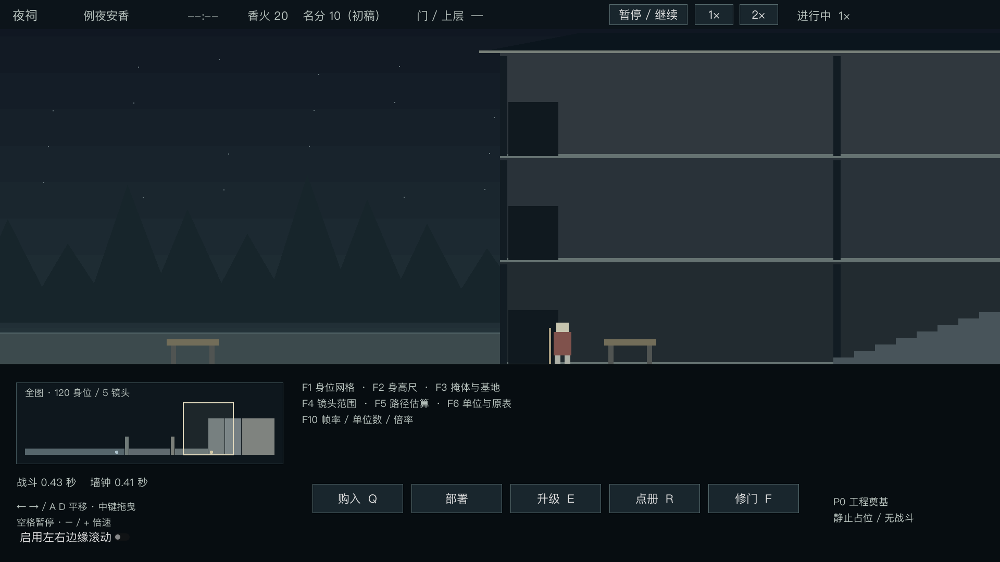
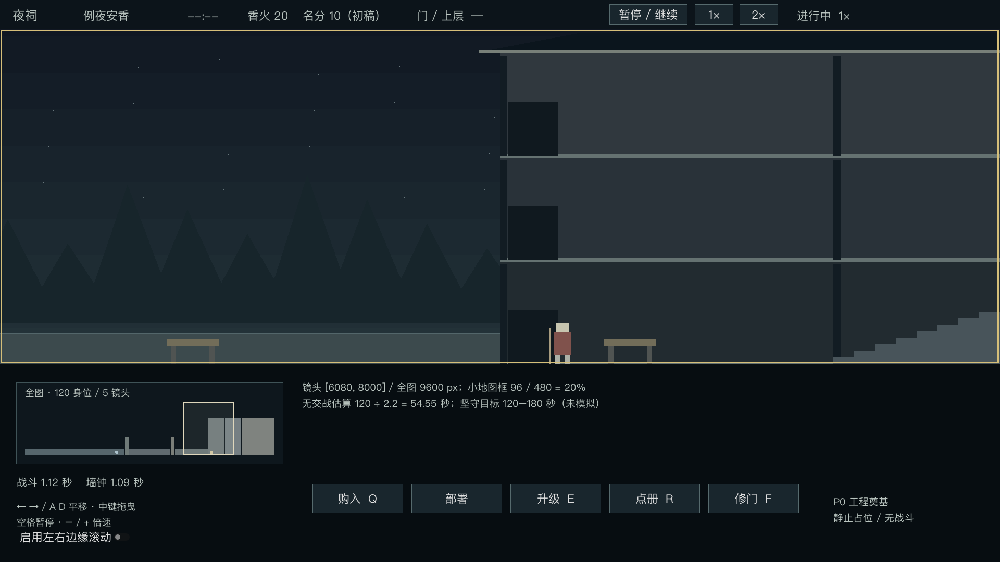

# P0 工程奠基阶段报告

验收日期：2026-11-17，Asia/Shanghai。环境：macOS 26.5.1 / arm64 / Apple M2 Pro，Godot `4.7.2.stable.official.ed1daf0bf`，OpenGL Compatibility。以下是本地验收快照，不是线上状态。

## 1. 本阶段目标是否达到（是/否）

**是。P0 的 K1–K14、S1–S6、A1–A3 全部通过本次自检。只完成 P0，尚未达到 G0。**

已建立独立游戏仓库 `ye-ci-game`，使用 GDScript。启动经过 Boot 数据校验进入静态战场；地图宽 9600 世界像素，默认镜头宽 1920、缩放 1，普通人鬼占位身高均为 80。启动切片是 `[6080, 8000]`（76–100 身位），显示内庭与祠堂前段。地平线 y=700，占逻辑高度 64.81%；下部 380 px，占 35.19%。小地图全宽 480 px，镜头框 96 px，宽度比 20%。

本阶段没有实现战斗、AI、伤害、技能、寻路、购入、点册、夜程或坐席切换；这些不是 P0 缺陷，也没有提前列为成果。未改动设计网站、GDD、标准图或源 CSV。

必读依据：[开发规范总说明、锁定清单、工程规范、阶段总表及 P0 全文](https://gh393872102.github.io/ye-ci/dev.html#d-p0)，[GDD 第 1、19.1、19.6、21 章](https://gh393872102.github.io/ye-ci/)。已打开图 [13](https://gh393872102.github.io/ye-ci/art/13-%E5%AE%9E%E6%9C%BA-%E9%95%9C%E5%A4%B4%E5%88%87%E7%89%87%E4%B8%8E%E5%85%A8%E5%9B%BE.jpg)、[07](https://gh393872102.github.io/ye-ci/art/07-%E5%AE%9E%E6%9C%BA-%E7%94%BB%E9%9D%A2%E6%A1%86-%E5%8F%82%E8%80%83%E6%9E%84%E5%9B%BE.jpg)、[25](https://gh393872102.github.io/ye-ci/art/25-%E5%AE%9E%E6%9C%BA-%E6%8E%A9%E4%BD%93%E4%B8%8E%E5%9F%BA%E5%9C%B0%E5%86%85%E9%98%B2%E5%AE%88.jpg) 对照镜头/小地图、画面框、掩体站位，未把旧稿中的庭院混战当成实现依据。

## 2. 新增或修改的主要文件

所有文件均在独立的 `ye-ci-game/` 内新增：

| 文件 | 内容 |
| --- | --- |
| `project.godot`、`export_presets.cfg`、`default_bus_layout.tres` | 分辨率、Nearest、Input Map、四个 Autoload、Windows 导出及 SFX/Music/Ritual 总线 |
| `scenes/boot/Boot.tscn`、`src/boot/Boot.gd` | 启动与加载错误拦截 |
| `scenes/combat/Combat.tscn`、`src/combat/Combat.gd` | 战场、相机、调试与 CanvasLayer HUD 的装配 |
| `src/autoload/Rules.gd` | 全部规定的工程常量，注明 GDD / P0 条款 |
| `src/autoload/Clock.gd` | 60 Hz 战斗时钟、暂停、1×/2×、独立墙钟与不加速冷却 delta 接口 |
| `src/autoload/Data.gd`、`src/data/CsvTable.gd`、`src/autoload/Events.gd` | 完整 CSV 校验、只读缓存、本地化入口、空信号总线 |
| `src/world/ReferenceMap.gd`、`data/levels/reference_gate_court.json` | 120 身位分区、三层占位、10 个掩体岗位、H09/G01 静止剪影 |
| `src/camera/BattleCamera.gd` | 方向键/A D/中键/可关闭边缘滚动及镜头边界 |
| `src/ui/CombatHUD.gd`、`src/ui/Minimap.gd`、`src/debug/DebugOverlay.gd` | HUD、全图小地图、F1–F6/F10 调试 |
| `data/units/*.csv`、`data/strings/zh_CN.csv`、`data/README.md` | 两张完整源表、四行杂兵、中文本地化与来源说明 |
| `tests/P0Suite.*`、`tests/fixtures/*`、`tests/test_boot_guard.py` | 规则、输入、真实渲染、数据失败与启动阻断验收 |
| `run.command`、`tools/godot.sh`、`tools/test.sh`、`tools/export_windows.py` | 运行、测试、隔离导出入口 |
| `README.md`、`THIRD_PARTY.md`、`.gitignore`、`docs/source-manifest.json` | 使用说明、权属和第三方、忽略规则、来源摘要 |

规范要求的其余目录及未来数据表已留空入口；不加载空表，不把它们计入后续阶段完成度。

## 3. 如何运行、如何打开调试项

本机双击 `run.command`，或在 Godot 导入 `project.godot` 后按 F5 运行。换机器时安装 README 指定版本并设置 `GODOT_BIN`。

```sh
./run.command
./tools/test.sh
./tools/godot.sh tests/P0Suite.tscn -- --capture
python3 tests/test_boot_guard.py --godot /absolute/path/to/Godot
```

手工验收步骤：

1. 启动：应看到内庭与祠堂前段、三层带、一枚门厅内侧人类占位；名册房在画外。人物和鬼物都是 80 px，不改变 zoom。
2. F1 开 80 px 网格；F2 开 80 px 身高及 104 px 门洞标尺。将镜头移至约 30–54 身位，对照接近段的普通鬼。
3. F3 检查 10 个岗位和基地范围，H09 位于 `post_hall_door`，G01 位于外门以左的接近段。退守竖线只是预留防线，不是寻路实现。
4. F4 开镜头框：默认 `[6080,8000]`；持续左移至 `[0,1920]`、右移至 `[7680,9600]`，不能再移出地图；小地图框始终为全宽的 1/5。
5. 空格暂停，观察战斗秒数冻结、墙钟继续；方向键、中键拖曳和 HUD 按钮仍可用。暂停中选择 2×，仍保持暂停；空格恢复后以 2×推进。减号或小键盘 `/` 选回 1×。
6. F5 应显示 `120 / 2.2 = 54.55 秒`；120–180 秒坚守只是目标，未进行战斗模拟。
7. F6 显示两枚占位的 floor_id/岗位/静态状态，并显示六个原表单位生命和技能；F10 显示 FPS、单位数、倍率。
8. 点击五个底栏按钮，得到“P4 实现”反馈，不产生资源或战斗变化。
9. 拖动窗口至非 16:9，应保持等比例、正常留边；单位和镜头世界宽度不变。

F7–F9 本阶段未绑定。手柄动作仅预声明，完整手柄焦点和指令轮盘在 P4。

## 4. 考核表逐条结果

### 关键项 K

| 编号 | 结果 | 证据与说明 |
| --- | --- | --- |
| K1 | 通过 | Godot 4.7.2 stable 正常 Boot→Combat；`run.command --headless --quit-after 60` 无脚本/资源错误；有窗口渲染通过 |
| K2 | 通过 | 1920×1080，canvas_items + keep；1440×900 窗口等轴缩放测试通过，实际内容截图为 1440×810，见图 10 |
| K3 | 通过 | BODY_PX 与 UNIT_HEIGHT_PX 均为 80；两枚实际剪影和 F2 标尺一致，门洞 104 px，见图 04/05 |
| K4 | 通过 | 地平线 700/1080=64.81%；下部黑场 35.19%；世界夜空有蓝青层次与远景，见图 01 |
| K5 | 通过 | 9600/1920=5；实际 Canvas 变换在左端、默认、右端均与相机世界范围吻合，见图 01/02/03 |
| K6 | 通过 | 启动切片 76–100 身位，左侧内庭被切开、右侧祠堂延续至画外；三层可见、后厢不入启动镜头，见图 01 |
| K7 | 通过 | 小地图展示全场分区，96/480=20%；三个机位的框位置与世界范围精确一致，无拉满，见图 07 |
| K8 | 通过 | 左右平移、中键拖曳、暂停平移实测；相机左缘夹在 0–7680；物理方向键事件另有验收 |
| K9 | 通过 | 120 个暂停逻辑步与实际帧等待均不推进战斗时间；墙钟继续、HUD 可点；1×/2×与 Space/+/-/小键盘 `/` 通过 |
| K10 | 通过 | 32+32+4 行加载；六名指定单位姓名/名称、生命、技能逐项断言；源表 SHA-256 与原件一致，见图 08 |
| K11 | 通过 | H09 位于 89.5 身位门厅岗位；G01 位于 44 身位接近段；庭院中央及外门外没有人类，见图 04/05/06 |
| K12 | 通过 | 120÷2.2=54.54545 秒，落在 45–70 秒；仅是 P0 规定的估算，见图 07 |
| K13 | 通过 | 未提供看全图相机；zoom 恒为 1；F4 只显示调试框，不改变视角 |
| K14 | 通过 | 目录、集中常量、四 Autoload、键鼠/手柄动作声明、本地化及音频入口完整；本报告按规定结构归档 |

### 应做项 S

| 编号 | 结果 | 证据与说明 |
| --- | --- | --- |
| S1 | 通过 | F1–F6/F10 逐个输入开/关验收，含身位、标尺、岗位/基地/退守线、镜头、路径、单位、FPS |
| S2 | 通过 | `post_gate_inner`、`post_barricade_outer_court`、`post_inner_gate`、`post_hall_door`、`post_window_1`、`post_window_2`、`post_table_hall`、`post_stair_head`、`post_register`、`post_rear` 全部建立 |
| S3 | 通过 | T01–T04 全部可加载；T03 的备注明确“初稿占位，待甲方或后续阶段校准” |
| S4 | 通过 | 无窗口 112 项、图形模式 123 项均 0 失败；另有源表与 Boot 拦截 14 项全部通过 |
| S5 | 通过 | 顶栏科仪/倒计时/香火/名分/门状态及底栏五指令齐全，空按钮有 P4 反馈 |
| S6 | 通过 | THIRD_PARTY 登记引擎与系统字体；缓存/导出/系统文件不提交；标准图未打包为素材 |

### 加分项 A

| 编号 | 结果 | 证据与说明 |
| --- | --- | --- |
| A1 | 通过 | 人类有头盔、衣身、双腿与持物；鬼是无面长袍剪影；三层 200 px 色块带可辨，见图 01/05 |
| A2 | 通过 | `tools/test.sh` 一键测试；测试失败或脚本错误会非零退出 |
| A3 | 通过 | 用同版本官方 Windows x86_64 release 模板导出 EXE/PCK；PCK 可由本机 Godot 启动；**未验证 Windows EXE 真机启动** |

### 自动检查证据

- [112 项规则与交互结果](p0-test-results.json)：0 失败。
- [123 项有窗口渲染与交互结果](p0-render-results.json)：0 失败，含 10 张真实引擎截图。它与无窗口套件大部分重叠，不把两者相加当作不同业务规则数。
- [14 项源表和启动拦截结果](p0-source-boot-results.json)：两个源表摘要一致；全部 CSV UTF-8 无 BOM / LF；在临时副本分别注入缺列和重复 ID，Boot 均以退出码 1 拒绝进入战斗。
- [Windows 导出摘要](p0-export-results.json)：包含 EXE/PCK 的大小及 SHA-256。测试包在 `exports/windows/`，不进入 Git。官方引擎 MIT 与版权说明已附包。
- 正常源码 Boot 与最终 PCK 均运行 60 帧退出，无脚本或资源加载错误。PCK 本机可加载不等于 Windows EXE 已测试。
- Shell 脚本语法检查通过；提交前执行 Git 差异空白检查。

六名指定单位的原始读数：

| ID | 姓名 / 名称 | 生命 | 专属技能名 |
| --- | --- | ---: | --- |
| H01 | 晚 | 70 | 点册 |
| H09 | 铁肩 | 110 | 扛门 |
| H17 | 朱砂 | 55 | 封门符 |
| G01 | 白衣无面 | 22 | 拥门 |
| G09 | 缢鬼 | 36 | 上梁 |
| G12 | 力士尸 | 70 | 撞门 |

数值调整记录：未修改两张源表中的任何数字或技能语义。名分显示 10 为 P0 指定允许的可见初稿；T03 的防御 5、速度 8 及其他补齐数值按 P0 初稿占位，不宣称为锁定平衡。层高选择 200、门洞选择 104，均在规定范围内。

### 截图对照

默认镜头（P0 几何占位，不是最终美术）：



全图两端与尺度：[潮源端](p0-shots/02-source.png)、[名册房端](p0-shots/03-register.png)、[人类 F2 标尺](p0-shots/04-height-human.png)、[普通鬼 F2 标尺](p0-shots/05-height-ghost.png)。

掩体与基地：[F3 岗位及退守线](p0-shots/06-cover.png)。



数据与操作：[六名原表单位](p0-shots/08-csv.png)、[暂停后平移与按钮反馈](p0-shots/09-paused.png)、[非 16:9 窗口内的等比画面](p0-shots/10-resized-16-10.png)。

### 写报告前的逐条自审

- [x] 未改设计、未换引擎；Godot 工程不在方案网站仓库内。
- [x] 默认不是全图，未推近镜头，普通单位身高 80 px。
- [x] 未实现战斗或 AI 以提前完成后续阶段。
- [x] 画面框、全图宽度、小地图镜头框、暂停时钟均有截图或测试证据。
- [x] 占位人类未站在庭院中央或外门以外。
- [x] CSV UTF-8 无 BOM / LF，六名指定单位读数正确。
- [x] K/S/A 每一行均给出结果与证据；平台未验证范围明示。
- [x] README 含精确引擎版本和运行方法。

## 5. 已知缺陷（必须列出）

当前未发现阻塞 P0 的缺陷。已知边界与未验证项：

1. Windows 测试包已导出，Windows EXE 的启动、字体与输入尚未在 Windows 系统实测，不能据此宣称可上架或跨平台验收完成。
2. 中文使用系统字体而未打包字体文件；本机中文呈现已检查，其他系统的字体回退未实测。
3. 未连接实体手柄；P0 只验证动作已声明，没有完整菜单焦点、轮盘或手柄通关承诺。
4. 场景是规范允许的几何/剪影占位；没有碰撞、自动移动、寻路、门破坏或技能。F5 是全图宽度估算，不是实际路径计时，120–180 秒坚守目标未模拟。
5. 未进行 Windows 中档机 150 单位性能验收；当前只有两枚静态占位，不能推断后续大潮帧率。
6. 本地独立 Git 仓库交付，未创建 GitHub 远端、未推送、未发布；公开/私有及远端许可仍由甲方决定。

## 6. 需要甲方拍板的问题

**无阻塞 P0 的设计或实现问题。** 本阶段沿用锁定。远端公开/私有未作擅自选择，不影响本地工程验收。

## 7. 下一步建议

仅进入 **P1 战场与镜头**：以当前 `reference_gate_court` 骨架实现真实可走楼层、房间、门、楼梯及障碍槽。保持 80 px 身位/身高、1920 px 默认镜头、9600 px 全图、y=700 地平线、小地图 20% 框、暂停时钟以及基地内掩体站位原则。

本次没有开始 P1。
