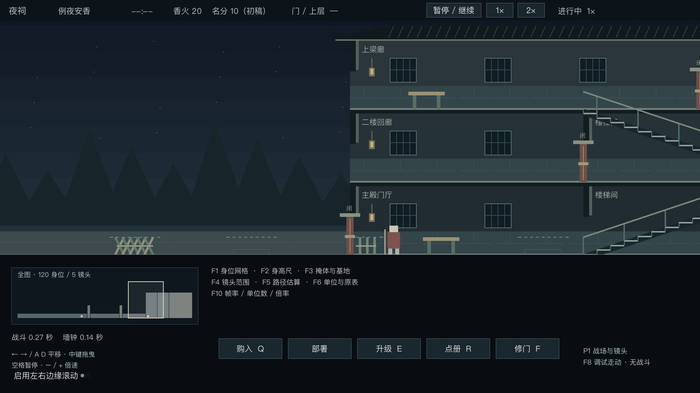
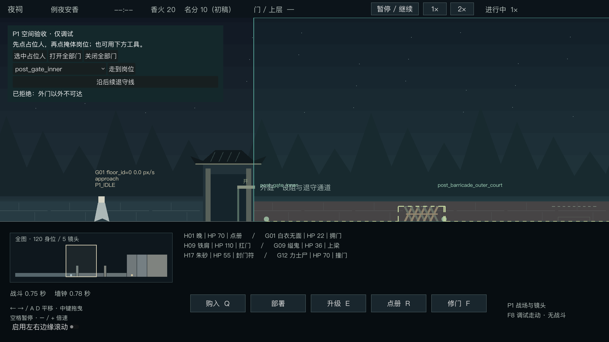
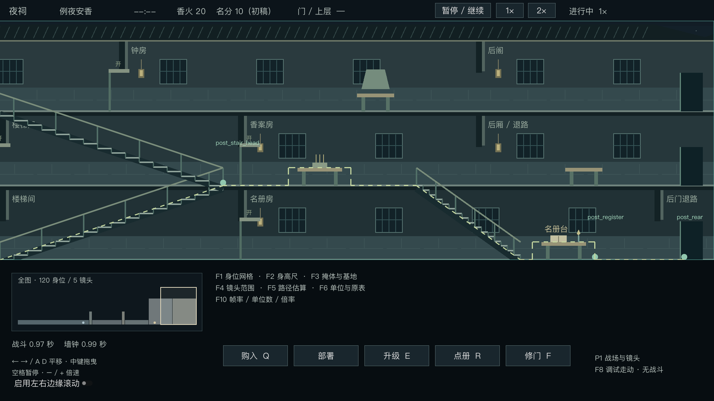

# P1 战场与镜头阶段报告

验收日期：2026-11-17，Asia/Shanghai。环境：macOS 26.5.1 / arm64 / Apple M2 Pro，Godot `4.7.2.stable.official.ed1daf0bf`，OpenGL Compatibility。以下为本地源码与引擎验收快照。

## 1. 本阶段目标是否达到（是/否）

**是。P1 的 K1–K12、S1–S4、A1–A2 全部通过本次自检。完成 P1，尚未达到 G0；本次没有开始 P2。**

在 P0 骨架上落实了 FloorBand、Room、Door、CoverPost、ObstacleSlot、RetreatLine、BaseRegion：祠堂三层连续可走空间、两进庭院、7 个有开闭与耐久接口的门、3 条可换层楼梯、6 个障碍槽（3 个默认占用）、10 个掩体岗位。F8 开发面板默认关闭，可选中占位人走至岗位及沿退守线移动。外门以外不可达，院心不能成为部署或停留指令目标。

保留 1 身位=80 px、普通单位高 80 px、全图 9600 px、默认镜头 1920 px / zoom=1、地平线 y=700。启动切片仍为 `[6080,8000]`（76–100 身位），祠堂从屏幕 x=960 开始，占右半部；屋脊约 y=66，三层地面 y=700/500/300。小地图框 96/480=20%。

依据：[开发规范总说明、锁定清单、工程规范、阶段总表、P0/P1 全文](https://gh393872102.github.io/ye-ci/dev.html#d-p1)，[GDD 第 6.1、6.6、16.3、19.1–19.6 节](https://gh393872102.github.io/ye-ci/)。已对照图 13（镜头/小地图）、25（站位）、11 和 09（仅室内比例）；没有采用图 11 的整场一屏机位。源页面和标准图摘要见 `docs/source-manifest.json`。未修改设计网站、GDD、标准图或人物/鬼物源 CSV。

## 2. 新增或修改的主要文件

| 文件 | 内容 |
| --- | --- |
| `data/levels/reference_gate_court.json` | 楼层、房间、门、楼梯、设施、岗位、障碍槽、退守线、基地与鬼路主路数据 |
| `src/world/ReferenceMap.gd` | 空间装配、房间/基地/岗位查询、碰撞与路线几何入口 |
| `src/world/WalkNetwork.gd` | 连续水平走带及显式楼梯连接；绕过设施缺口，拒绝关闭的门和基地外目标 |
| `src/world/WorldDoor.gd`、`WorldObstacle.gd` | 物理碰撞、开闭/占用状态、耐久字段及边界约束接口 |
| `src/world/MapDrawing.gd` | 三层剖视、门、楼梯、梁柱、窗、桌案、名册台火苗及退路剪影 |
| `src/debug/DebugWalker.gd`、`WalkDebugger.gd` | Clock 驱动的验收走动、连续爬梯、F8 独立开发面板及非法目标反馈 |
| `src/debug/DebugOverlay.gd` | F2 设施标尺；F3 绕障与楼梯退守折线、基地及庭院禁前线区；F6 走速/楼层 |
| `src/autoload/Rules.gd` | P1 的走带深度、缺口、脚部半径、楼梯速度和桌案尺寸常量 |
| `src/combat/Combat.gd`、`src/ui/CombatHUD.gd`、`Minimap.gd` | 接入独立调试层、F5 几何主路时间、小地图单位高度映射 |
| `project.godot`、`data/strings/zh_CN.csv` | F8 输入与 P1 中文提示；正常玩家指令仍为 P4 占位 |
| `tests/P1Suite.*`、`tests/P0Suite.gd`、`tools/test.sh` | P1 验收、一键 P0/P1 回归；P0 回归证据另存，不覆盖历史报告/截图 |
| `README.md`、本报告、`p1-*-results.json`、截图目录 | 运行、手工步骤、逐条考核与真实引擎证据 |

### 接口与数据交接

- 基地边界从 50 身位起（外门内沿）；`is_outside_gate(x)`、`inside_base(pos)`、`is_open_court(pos)`、`is_cover_post(pos)`、`can_deploy_at(post_id)` 可查询。庭院在基地内、允许经过，中心没有岗位。
- `floor_id=0` 为地面，`1` 为接近段独立中层台，`2` 为祠堂二楼，`3` 为梁层；1 与 2 高度相同但不连通。人类路线不得经外部中层台抄近路。
- 楼梯主段水平占宽 7.5 身位，后段 3.5 身位，均超过 1 身位；斜段连续行走，抵达落点后更新 `floor_id`。
- `WorldDoor.set_open()` 同步逻辑阻挡并延后更新物理碰撞；`set_durability()` 只约束在 0–最大值，不擅自实现破门/修复。障碍另有 `set_occupied()`。
- `navigation.route()` 只服务当前显式空间；`DebugWalker` 是验收占位，不是 P2 职分 AI。F3 退守折线为忽略门开闭的静态路线预览；实际走动仍检查关闭的门。
- 完整退守顺序为 `post_gate_inner → post_barricade_outer_court → post_inner_gate → post_hall_door → post_stair_head → post_register → post_rear`，途中穿过缺口并上下楼梯，不在院心停留。

## 3. 如何运行、如何打开调试项

双击仓库中的 `run.command`，或导入 `project.godot` 后按 F5。使用 README 指定的 Godot 精确版本。

```sh
./run.command
./tools/test.sh
./tools/godot.sh tests/P1Suite.tscn -- --capture
./tools/godot.sh tests/P0Suite.tscn -- --capture --report-prefix=p1-p0-regression
```

手工验收步骤：

1. 启动：内庭在左、祠堂三层在右；H09 在门厅内侧，名册房和接近段大部在画外。F2 看人高 80、门高 104、层高 200、桌案 48 px。
2. 方向键 / A D / 中键平移至左右端。左端可看长接近段及 24–40 身位的中层台；右端可见楼梯、名册房、火苗、后厢与后门退路。F4 显示切片范围，小地图框始终 20%。
3. 按 F8 打开开发走动面板。点「选中占位人」，选 `post_inner_gate`，点「走到岗位」：默认主殿门关闭，应提示门或障碍阻路，人物不瞬移。
4. 点「打开全部门」，再选 `post_table_hall`，应绕过桌案背侧缺口。选 `post_window_1`，开启 F6：人物沿楼梯逐步上二楼，斜段 105.6 px/s（水平 176 px/s 的 60%），到落点才从 floor 0 改为 2。
5. 选 `post_window_2`，经第二段楼梯到 floor 3；再选 `post_gate_inner`，经楼梯及两院缺口返回外门内侧，不能越过基地界。
6. 从 `post_gate_inner` 点「沿后续退守线」，依次经过上述掩体、门厅和楼梯，经名册房到后门；F3 显示对应折线。
7. F8 开启且选中人时，向左平移并点击外门外地面，提示「已拒绝：外门以外不可达」；点击庭院中心，提示院心不是岗位。人物不能在那里部署或停留。
8. 走动中按 Space：人物与战斗钟冻结，镜头和 UI 仍可操作。恢复后继续走动。再次 F8 关闭开发面板；正常玩家 HUD 没有手动移动命令。
9. F5 显示鬼路主路 116 身位、52.73 秒；不把退守绕路算作鬼路，也不把 120–180 秒坚守目标视作已测试。

F1 网格、F2 标尺、F3 掩体/退守/基地、F4 镜头、F5 路径、F6 单位/原表、F8 开发走动、F10 帧率。F7/F9 未绑定。手柄仍只有 P0 动作入口，完整交互留至 P4。

## 4. 考核表逐条结果

### 关键项 K

| 编号 | 结果 | 证据 |
| --- | --- | --- |
| K1 | 通过 | 完整 P0 回归：无窗口 112 项、有窗口 123 项均 0 失败，含 K3–K9/K12；原始尺度、地平线、Clock 保留 |
| K2 | 通过 | 默认 `[6080,8000]`，左右切开；小地图 96/480=20%；真实 Canvas 变换及边界回归通过，见图 01/11 |
| K3 | 通过 | 默认同时见内庭、主殿门、三层剖视，祠堂占右半部；人类仍 80 px，见图 01/02 |
| K4 | 通过 | 门洞 104 px=1.3 身位，层高 200 px=2.5 身位，桌案 48 px=0.6 身位；上方净空明显，见图 02/03 |
| K5 | 通过 | 地层有门厅/名册房；二楼有回廊/香案房/后厢；梁层有梁廊/钟房/后阁；主要室内房间宽至少 8 身位，见图 01/03 |
| K6 | 通过 | 10 个岗位全部可达；同层绕设施缺口，关门拒绝路线；物理射线验证关门有碰撞、开门移除，行进中关门也停在安全侧 |
| K7 | 通过 | 3 条楼梯具真实宽度；两段上楼到 floor 2/3，无瞬移；105.6/176=60%，见图 06 与逐步速度断言 |
| K8 | 通过 | 外庭 50–70、内庭 72–88 身位，外门与主殿分离；每处两槽且保留缺口，默认人类在门内侧，见图 01/04/09 |
| K9 | 通过 | 从外门内侧完整走至后门，逐个断言经过 7 个规定岗位；F3 绘实际绕障/楼梯折线，见图 09/10 |
| K10 | 通过 | 基地内沿边界、两院范围、非庭院上层位置查询通过；外门外和外部中层台路线拒绝；图 07/08 给出非法目标反馈 |
| K11 | 通过 | 潮源到名册的主路长 9280 px=116 身位，除以 2.2 得 52.72727 秒，位于 45–70 秒，见图 11 |
| K12 | 通过 | 本报告含规定七部分、逐项考核、手工步骤、默认机位/室内/退守/非法目标截图及未验证范围 |

### 应做项 S 与加分项 A

| 编号 | 结果 | 证据 |
| --- | --- | --- |
| S1 | 通过 | 外庭、内庭各一道默认拒马，门厅门口一道木栅；另三槽为空，图 01/04/09 可见 |
| S2 | 通过 | 接近段 24–40 身位有独立中层台，见图 05；不是默认人类可达路线 |
| S3 | 通过 | 二楼后厢与地层后门逃跑空间可见，末端岗位可达，见图 03/10 |
| S4 | 通过 | 7 门具最大/当前耐久与 setter，上下界测试通过；暂不实现受击和破坏 |
| A1 | 通过 | 梁柱、台阶栏杆、窗、桌案、香炉、钟架、名册与火苗剪影可辨；仍为 P1 几何表现，见图 03 |
| A2 | 通过 | 自动覆盖基地外不可达、爬梯 floor_id 连续转换与主路时间，另测门碰撞、退守、暂停 |

### 自动验证证据

- [P1 无窗口 112 项](p1-test-results.json)：0 失败。
- [P1 有窗口 123 项](p1-render-results.json)：0 失败，保存 11 张真实引擎截图。
- [P0 无窗口回归 112 项](p1-p0-regression-test-results.json)与[P0 有窗口回归 123 项](p1-p0-regression-render-results.json)：均 0 失败。另存 10 张回归截图，含全图左右端、暂停交互和非 16:9 窗口。
- 四组结果有重叠，不把合计数宣称为不同业务规则数。最终运行日志无 `SCRIPT ERROR`、`ERROR`、`FAIL`；脚本导入及主场景 Boot→Combat 60 帧启动检查通过。
- `tools/test.sh` Shell 语法与 Git 差异空白检查通过。人物、鬼物、杂兵 CSV 与 P0 提交无差异。
- 受限执行环境首次无窗口检查曾出现系统字体访问错误；随后在可读取 macOS 系统字体的本地执行环境完成以上全部最终验收，错误未复现。首次日志不作为通过证据。

数值与布局记录：未改源 CSV 或 P0 锁定尺度。P1 选用楼梯倍率 0.60、桌高 48 px、走带深 64 px、背侧路径偏移 48 px、脚部半径 18 px、绕障横向余量 24 px。门耐久 240/180/160/140/120/120/120、障碍耐久 80 只是接口初稿占位，未用于战斗平衡；设施默认耐久 0，不宣称可战斗摧毁。为留出实际楼梯落点，上层桌案位于 90 身位，名册房门位于 104.4 身位，未调整全图/镜头宽。P0 全图估算仍是 120÷2.2=54.55 秒，P1 F5 改为量至名册位置的 116÷2.2=52.73 秒，两者终点不同。

### 截图对照

默认机位（P1 几何表现，非最终美术）：



[尺寸标尺](p1-shots/02-scale.png)、[三层室内、名册台及后厢](p1-shots/03-interior.png)、[外门与外庭](p1-shots/04-two-courts-outer.png)、[接近段中层台](p1-shots/05-approach-platform.png)、[楼梯连续移动及 105.6 px/s](p1-shots/06-stair-transit.png)。



[庭院中心目标拒绝](p1-shots/08-illegal-court.png)、[庭院退守折线](p1-shots/09-retreat-courts.png)。



[F4 小地图与 F5 主路时间](p1-shots/11-minimap-path.png)、[P0 回归：非 16:9 窗口](p1-p0-regression-shots/10-resized-16-10.png)。

### 自我审核清单

- [x] 没有改身位、镜头宽、全图宽，没有把默认镜头做成全图或推近。
- [x] 没有把第 11 号过程稿的整场一屏当作默认机位。
- [x] 人类占位和默认岗位符合第 25 号图，院心与外门外没有默认人类岗位。
- [x] 楼梯、门、房间可行走/阻挡；岗位是空间内的目标点，不是把单位锁死的塔防坑。
- [x] 考核表逐条作答，报告与真实截图已归档。

## 5. 已知缺陷（必须列出）

当前未发现阻塞 P1 的缺陷。已知边界与未验证范围：

1. 画面仍为 P1 几何/剪影表现；三维错觉、角色动画和正式美术未在本阶段实现。绕设施使用同一楼层内的背侧走带，脚部位置计算碰撞，尚无角色彼此避让。
2. 调试单位只用于单人空间验收，没有职分 AI、攻击、伤害、自动破门、自动撤退触发或玩家部署；正常 HUD 的五指令仍是 P4 占位。
3. F5 是实测几何长度除以基准速度；没有移动鬼物端到端计时，没有模拟障碍防守 120–180 秒。门和障碍初稿耐久未做平衡验收。
4. 当前空间网络针对这一张静态验收图。F3 退守线忽略门开闭以显示完整路线；后续若动态改布局，须同步刷新预览，不能将其当作实时可达性承诺。
5. Windows EXE 真机、实体手柄、150 单位大潮性能及跨平台系统字体均未验证。本轮没有重新导出 Windows 包；`exports/windows/` 是 P0 历史包，P1 以当前源码运行。
6. 代码与证据仅交付到本地独立仓库。没有创建远端、推送或发布，设计网站未改动。

## 6. 需要甲方拍板的问题

**无。** 未发现阻塞 P1 的设计冲突。沿用锁定规则；门与障碍耐久仅为本阶段接口占位，不新增平衡结论。

## 7. 下一步建议

仅进入 **P2 单位与职分 AI**：先按 P2 必读章节和标准图核对，再从源表生成指定人类单位，复用本阶段岗位、退守线、基地查询和门/障碍接口。保持已验收尺度、镜头、小地图与暂停规则。本次没有实现或提前验收 P2。
