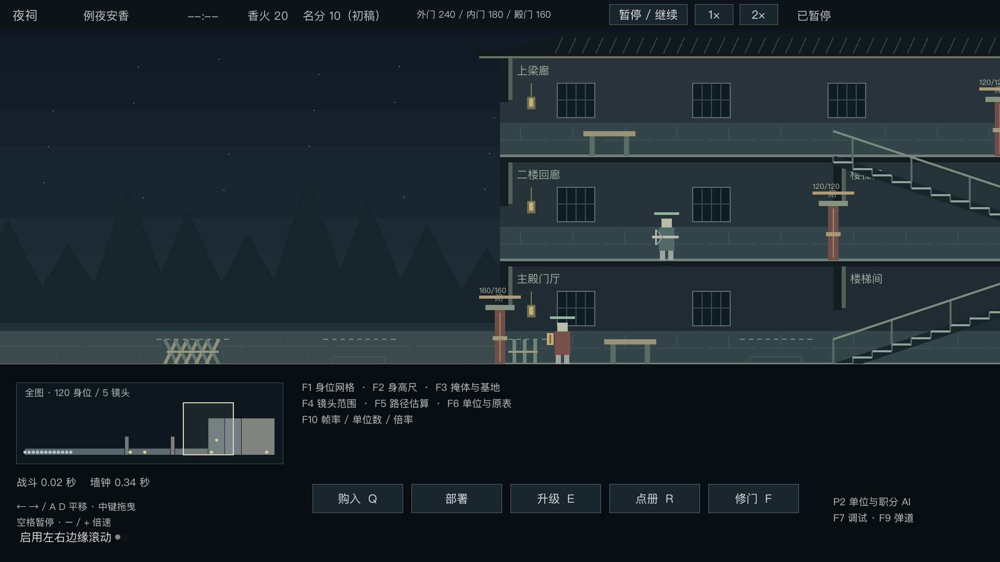
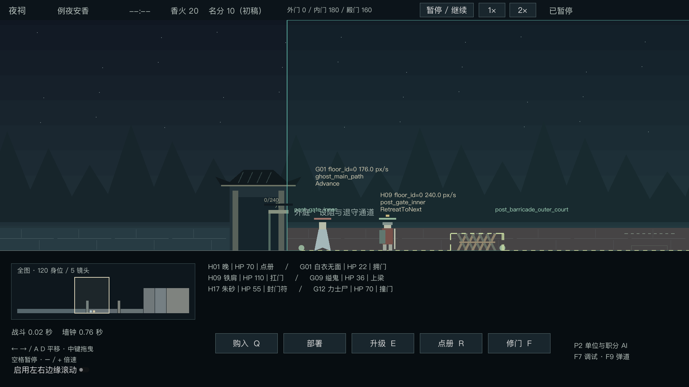
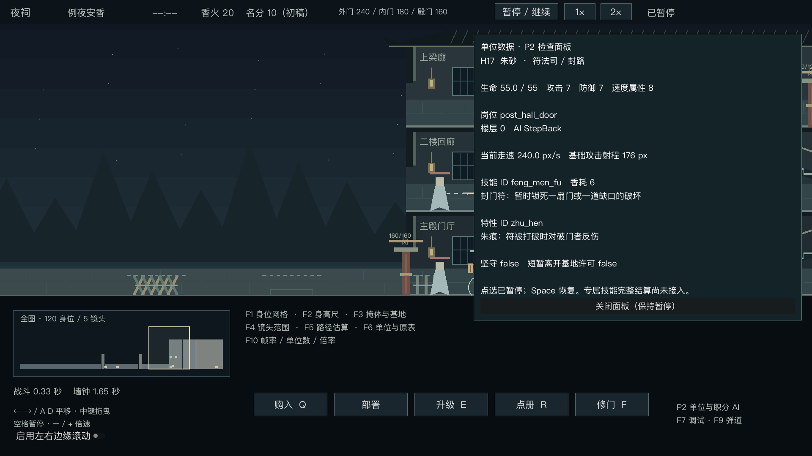

# P2 单位与职分 AI 阶段报告

验收日期：2026-11-17，Asia/Shanghai。环境：macOS / arm64 / Apple M2 Pro，Godot `4.7.2.stable.official.ed1daf0bf`，OpenGL Compatibility。本报告记录本地源码、确定性模拟及真实引擎渲染的验收快照，不代表线上或 Windows 真机结果。

## 1. 本阶段目标是否达到（是/否）

**是。P2 的 K1–K10、S1–S4、A1–A2 全部通过本次自检。未开始 P3，尚未达到 G0。**

正常启动使用表驱动「G0 守香布置」：铁肩守外门内侧，乡勇守外庭拒马，朱砂在门厅内侧，弩手在二楼窗位，晚在名册旁。默认 12 个行走靶从潮源前进，可攻击门、障碍与人。武卫有限追击并返回掩体，远程被近身时先撤；门毁、该段障碍拆尽或 3:1 持续 2.5 秒触发自动退守，最终守住名册位置。玩家点空地不产生移动命令。

默认三人没有出界许可。远程有实体弹道、飞行时间及门/柱/障碍遮挡。晚的点册已实现合法施术位置和读条接口，不走进院心或追出基地。暂停同时冻结单位、行走靶、弹道、攻击计时和读条。

身位、镜头、地图、地平线、岗位及 P1 楼梯坐标均保持：普通单位 80 px，全图 9600 px，镜头 1920 px / zoom=1，启动 `[6080,8000]`，小地图框 96/480=20%。

必读依据：[开发规范总说明、锁定清单、工程规范、P1/P2 全文](https://gh393872102.github.io/ye-ci/dev.html#d-p2)，[GDD 第 6.2、6.3、6.5、6.6 节、第 10 章晚/铁肩/朱砂条目及第 15.1 节](https://gh393872102.github.io/ye-ci/)。本轮重新获取两页，摘要与 P1 相同。已打开图 25（站位）、13（镜头/小地图）、24（技能可读性）；未采用图中旧稿的院心站位。未修改设计网站、标准图及原 CSV。

## 2. 新增或修改的主要文件

| 文件 | 内容 |
| --- | --- |
| `data/units/p2_combat.json`、`src/data/CombatCatalog.gd`、`src/autoload/Data.gd` | 行为与技能/特性 ID 映射，核对源表名称、合法角色/射程和默认基地许可；错误由 Boot 拦截 |
| `data/levels/p2_defense.json` | 五人预设、岗位保护对象、下一掩体；不改 P1 空间坐标 |
| `src/units/CombatUnit.gd` | 源表四维/身份、生命、状态、岗位、旗标、倒下与职分剪影 |
| `src/ai/HumanBrain.gd`、`GuardPolicy.gd` | 武卫/远程/守香司状态机、硬基地约束、有限追击、持续压线、坚守与自动退守 |
| `src/ai/BaseExcursion.gd` | 显式标记任务、许可、截止时间及强制返回；本阶段只用临时探针验证 |
| `src/combat/Formula.gd`、`CombatSimulation.gd` | 单一伤害公式、模拟步进、掩体/单位查询、门的自动通行、战斗事件/攻击记录 |
| `src/combat/Projectile.gd` | 有限速度/射程的实体弹道，逐段取最近遮挡或命中，避免跨帧穿透 |
| `src/combat/skills/DianCe.gd` | 点册位置校验、指定/自动目标和 4 秒读条接口，无完整超度结算 |
| `src/ai/DebugTargetBrain.gd` | 沿地面主路前进、撞门、拆障、攻击的验收行走靶；非 P3 鬼潮 |
| `src/ui/BattleInspector.gd` | 点击单位自动暂停与原表信息检查；默认关闭的 F7 开发工具 |
| `src/world/WorldDoor.gd`、`WorldObstacle.gd` | 共享伤害入口驱动的耐久归零与破坏，保留 P1 setter 语义 |
| `src/combat/Combat.gd`、HUD/Minimap/DebugOverlay、`project.godot` | 正常 P2 启动、门耐久、生命条、F6 状态、F7/F9；P0/P1 仅空间回归模式 |
| `tests/P2Suite.*`、P0/P1 套件、`test_boot_guard.py`、`tools/test.sh` | 攻击/遮挡/基地/退守/暂停验收与源表/引用失败拦截，历史报告另存不覆盖 |

### 已实现与预留的区别

- 四维、标签、技能/特性原文、技能香耗来自 CSV；补充 JSON 不复制或改写这组原始数值。H01=70/8/8/10、香耗4；H09=110/10/16/5、香耗4；H17=55/7/7/8、香耗6。
- 扛门、封门符、青灯眷顾、门仆、朱痕已建立 ID、源文校验和展示；**完整专属技能/特性效果尚未执行**。P2 K1 验收的是正确加载与共享公式；不能把这些数据入口说成技能效果已完成。
- 朱砂的短符是 P2 基础攻击，未把它冒充封门符。点册只有施术/读条接口，完成时不花香火、不超度、不收编、不发奖励。
- 人类下一据点以 P2 防线数据为准，最后到名册；P1 的全退守预览仍包含后门逃跑空间，P2 不提前实现逃跑/胜负结算。
- 临时探针只验证出界扩展框架，不实现归客猎步和榫卯修门；默认三人标志持续为 false。

## 3. 如何运行、如何打开调试项

双击 `run.command`，或在 Godot 导入 `project.godot` 后按 F5。精确版本及换机方式见 README。

```sh
./run.command
./tools/test.sh
./tools/godot.sh tests/P2Suite.tscn -- --capture
python3 tests/test_boot_guard.py --godot /absolute/path/to/Godot --report-prefix p2
```

手工验收步骤：

1. 默认启动：内庭与三层祠堂切片不变，朱砂在门厅、弩手在窗位；向左平移看铁肩/乡勇贴掩体，向右看晚在名册旁。F2 测身高，F3 看岗位，F4 看镜头/小地图。
2. 左键点击任一人物，检查四维、技能/特性原文、岗位、floor_id 和 AI 状态；游戏自动暂停。关闭面板保持暂停，Space 恢复；点空地不发移动命令。
3. F7 打开开发面板，选择「门前压测」可把 6 个行走靶放在门前，以减少等待。它们会实际撞门和拆障。观察 3:1 持续约 2.5 秒后守军退到下一掩体，不在院心建立新前线。
4. 点击铁肩后开启「坚守」，Space 恢复：单纯数量压线不撤；门或掩体被完全拆毁仍撤。F6 显示状态和速度，地面退守 240 px/s，行走靶基准 176 px/s。
5. F9 打开近期发射射线；弩手/朱砂的弹道有飞行时间，门、柱和完整障碍遮挡。确定性的开门发射后关门、障碍移除和名册到外门超距测试由套件逐项验证。
6. 晚对已进入门厅的目标可在名册旁开始读条。F7 指定接近段行走靶应提示拒绝位置；不会把晚带到外门外。完整读条的可重复场景由套件构造，见图 10。
7. 在单位移动、弹道飞行或读条时按 Space，应全部冻结；镜头和菜单继续工作。选 2×再恢复，模拟用倍速推进。
8. F7「临时出界探针」会单独生成无攻击探针并打开外门；其任务结束或截止时间到后返回原掩体，不改变默认人物权限。恢复「G0 守香布置」会移除探针并还原门/障碍。
9. F7「潮源刷 12 靶」最多加到 20 个，重复添加寻找空槽；「清除行走靶」会清除靶与弹道并取消相关读条。正常玩家 HUD 仍不包含这些验收命令。

F1 网格、F2 标尺、F3 掩体/退守、F4 镜头、F5 主路估算、F6 状态、F7 P2 调试、F9 射线、F10 帧率。正常 P2 没有 P1 的 F8 手动走到面板。

## 4. 考核表逐条结果

### 关键项 K

| 编号 | 结果 | 证据与说明 |
| --- | --- | --- |
| K1 | 通过 | 三人及两杂兵四维逐项等于 CSV；技能/特性原文与 ID、香耗核对。真实近战记录铁肩10攻对3防造成8.5，弹道记录弩手9攻对3防造成7.5，均经 Formula |
| K2 | 通过 | 铁肩门内、乡勇拒马后、朱砂门厅内、弩手窗位、晚名册；开场逐个断言合法掩体，图 01/03/04 |
| K3 | 通过 | 门外目标不能引出铁肩；近距攻击真实扣血；室内左右方向有限追击、目标消失回位，最大离岗2.5身位，院心目标被硬规则拒绝 |
| K4 | 通过 | 弩手6身位射程、实体飞行延迟；关闭门阻止发射、发射后关门拦截；完整障碍和柱体遮挡；从名册向外门在实际攻击入口拒绝，图05/06 |
| K5 | 通过 | 门毁/障碍拆尽和3:1持续2.5秒均自动触发；比例中断会清零计时；逐个走过外门→拒马→内门→门厅→楼梯→名册，无瞬移/院心停留，图07–09 |
| K6 | 通过 | 实测水平撤退240 px/s（3.0身位）大于最快普通2.4身位；跟随靶使用176 px/s，守军先到下一掩体，图07/08；楼梯仍按0.60倍率 |
| K7 | 通过 | 晚拒绝外门外指定目标；在名册对已入门厅目标开始读条；院内掩体也不能作为施术位置，不向目标移动，图10 |
| K8 | 通过 | 真实 Clock 帧先启动单位/弹道/读条，再暂停；位置、生命、攻击计时、弹道位置/剩余程、读条进度和模拟时间全部不变；恢复后继续 |
| K9 | 通过 | P0/P1 各112项空间回归通过；另在正常 P2 场景验三个机位实际 Canvas、小地图20%、80px单位、默认缩放和16:10等比，图01/02/12 |
| K10 | 通过 | 本报告按固定七部分归档，含逐项证据、已知边界、手工步骤、攻击记录和阶段截图 |

### 应做项 S 与加分项 A

| 编号 | 结果 | 证据与说明 |
| --- | --- | --- |
| S1 | 通过 | 真实鼠标点击选择人物、自动暂停，面板含四维、岗位、floor_id、AI、技能和特性，图11 |
| S2 | 通过 | 人和靶生命归零进入 Broken，停止战斗并离开活跃列表，短暂倒下剪影后移除；无复活 |
| S3 | 通过 | 默认人物调用例外接口被拒绝；临时探针需显式许可和已标记任务；完成/超时都返回，测试截止时间中断出发，图11a |
| S4 | 通过 | 七门有当前/最大耐久条与数字，顶栏显示外/内/殿门耐久，随真实撞门变化 |
| A1 | 通过 | 武卫甲/盾/兵器、弩手横弩、朱砂符纸、晚杖与灯可区分；保持80px剪影，图01/03/04 |
| A2 | 通过 | 自动覆盖默认出界失败、院心不停留、名册到外门超距拒绝及全模拟暂停冻结 |

### 验证结果与证据解释

- [P2 无窗口 114 项](p2-test-results.json)：0 失败。
- [P2 有窗口 130 项](p2-render-results.json)：0 失败；含15张真实引擎截图及非16:9比例检查，与无窗口用例重叠，不相加宣称独立规则数量。
- [P0 空间回归 112 项](p2-p0-regression-test-results.json)、[P1 空间回归 112 项](p2-p1-regression-test-results.json)：均0失败。两套历史用例显式运行仅空间模式，保留原占位验收；P2默认战斗场景另测镜头、输入和暂停，不以旧模式代替新模式验收。
- [源表与启动拦截15项](p2-source-boot-results.json)：源 CSV SHA-256 与原件一致、UTF-8无BOM/LF；临时副本注入缺列、重复ID、无效技能ID均以退出码1拒绝战斗，无脚本异常。
- [默认启动检查](p2-startup-results.json)：Boot→Combat 120帧，退出码0，无脚本或资源错误。最终图形/无窗口日志无 `SCRIPT ERROR`、`ERROR`、`FAIL`。
- Shell脚本语法、最终Git差异空白、文档链接和无关文件检查完成。未安装新依赖，未运行远程业务或生产写入。

攻击/退守记录存于 P2 JSON 的 `attack_evidence` / `retreat_evidence`。测试中的单门一击破坏用例把**当前耐久**设为6，以准确触发转换；并另有不改默认门/障碍耐久、12靶从潮源出发的75秒固定步长集成运行，记录在 `integration_evidence`。该运行外门被拆、外庭障碍被拆，铁肩和乡勇向内门退守，所有存活守军保持基地约束，且共用掩体时没有持续叠在同一像素。

固定步长用例直接调用同一模拟器推进，便于复现边界；另用真实物理帧验证 Clock 接入、鼠标/键盘和暂停。固定步长截图中的顶栏 Clock 时间不等于该用例已经模拟的总秒数。**75秒集成运行不是 P3 的完整鬼潮、无交战行程或120–180秒坚守验收。**

### 初稿数值与实现选择

未修改源 CSV、地图尺度或岗位坐标。本轮新增参数：攻击间隔1.1秒，防御系数0.5，抗性修正默认1，水平退守3.0身位/秒，弹道7.0身位/秒，数量比3:1、持续2.5秒、检测半径4身位；近身警戒1.4身位；院内掩体附近可停留余量0.8身位。武卫基础射程1.0/1.2，朱砂普通短符2.2，弩手6身位。点册接口4秒，不结算资源。CSV速度仍是原始属性，基准世界步行统一2.2身位/秒。

多名守军到同一掩体时，在合法走带和掩体范围内预留相邻站位，保持同一防线语义；不是新增塔防格子。友军退守通过完好的内门时自动开门，在通道无人后关闭；门毁则保持开放。坚守抵抗数量压线，不能抵抗站位掩体毁坏。

### 截图



[F2尺度](p2-shots/02-scale.png)、[前线掩体](p2-shots/03-front-cover.png)、[名册旁的晚](p2-shots/04-register-caster.png)、[实体弹道](p2-shots/05-projectile-flight.png)、[门阻挡弹道](p2-shots/06-door-blocks-shot.png)。



[先抵达下一掩体](p2-shots/08-hold-next-cover.png)、[完整退到名册](p2-shots/09-register-final-line.png)、[安全位置读条](p2-shots/10-safe-channel.png)、[临时例外探针](p2-shots/11a-exception-probe.png)。



[F7开发面板](p2-shots/11b-debug-panel.png)、[暂停与非16:9窗口](p2-shots/12-paused-resized.png)、[12靶潮源出发75秒快照](p2-shots/13-source-run-75s.png)。

### 自我审核清单

- [x] 没有把框选或点地移动做成玩法；P1手动走动只保留在空间回归场景。
- [x] 没有为了看清人物推近镜头、放大单位或改变小地图比例。
- [x] 默认三人不会冲出外门，例外探针独立且有强制返回。
- [x] 退守可穿庭院，不把院心当新前线；掩体空间内允许有限移动。
- [x] 所有实际伤害从 Formula 入口计算，没有技能/坐席私有伤害公式。
- [x] 考核逐条作答，数据、确定性模拟、真实帧和未验证范围分开说明。

## 5. 已知缺陷（必须列出）

当前未发现阻塞 P2 的缺陷。已知范围与未验证项：

1. 扛门、封门符及各专属特性的完整效果仅预留并展示原文；点册仅位置/读条接口。没有超度、收编、资源支付/奖励和胜负结算，不能据此宣称 G0 完成。
2. 行走靶是 P2 的单列地面压线工具，上限20；没有正式2–4排潮水、力士、缢鬼或楼层进攻策略。定点上层靶只用于射击/退守测试，不是已经实现上梁AI。
3. 图形仍为阶段允许的几何与职分剪影，尚无精绘立绘、完整攻击动画、成套技能特效和音效。密集打开F6时调试文本仍可能重叠，可点选读取单体面板。
4. 完成了当前5名守军的掩体站位预留与最多20靶的前后间距；没有通用拥挤人群避让或150单位大潮性能验收。不得据此推断后期密度和Windows帧率。
5. 门/障碍初稿耐久沿用P1，未做最终战斗平衡；75秒压力用例不是P3路径时间门槛。后续调数值须另记旧值/新值，不能改基地和退守骨架。
6. Windows真机、实体手柄和跨平台系统字体未验证。本轮未重新导出Windows包；`exports/windows/`仍为P0历史测试包，P2运行当前源码。
7. 源码和证据仅在本地独立仓库交付，没有创建远端、推送或发布。

## 6. 需要甲方拍板的问题

**无。** 未发现阻塞本阶段的设计冲突；基础攻击、点册接口、正式专属技能效果和P3鬼潮的边界按本阶段范围分别说明。

## 7. 下一步建议

仅进入 **P3 鬼潮与路径时间**。保持人类职分AI、基地硬规则、共享公式、岗位/退守线和镜头尺度，用正式鬼潮、力士和缢鬼替换本阶段行走靶，实际测量无交战行程、正常坚守到名册的时间，以及规定的单位数量下帧率。本轮没有开始P3。
